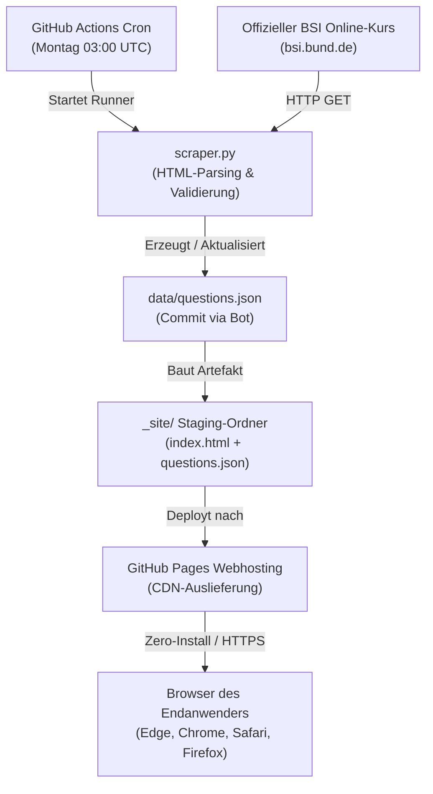

# BSI IT-Grundschutz Praktiker Web-Trainer – Struktur & Konfiguration

Dieses Dokument beschreibt die vollständige Architektur, Verzeichnisstruktur, Datenflüsse und technischen Konfigurationen des BSI IT-Grundschutz Praktiker Web-Trainers.

:::info
**Schnellzugriff & Repositories:**

* **GitHub Repository:** [github.com/nils-b-beep/bsi-grundschutz-praktiker-WEB](https://github.com/nils-b-beep/bsi-grundschutz-praktiker-WEB)
* **Live Web-App (GitHub Pages):** [nils-b-beep.github.io/bsi-grundschutz-praktiker-WEB](https://nils-b-beep.github.io/bsi-grundschutz-praktiker-WEB/)
* **Offizielle BSI-Quelle:** [BSI IT-Grundschutz Online-Kurs](https://www.bsi.bund.de/DE/Themen/Unternehmen-und-Organisationen/Standards-und-Zertifizierung/IT-Grundschutz/Zertifizierte-Informationssicherheit/IT-Grundschutzschulung/Online-Kurs-IT-Grundschutz/online-kurs-it-grundschutz_node.html)

:::

---

## 1. 🏗️ Projekt- & Dateistruktur

Das Repository ist als rein statische Web-Applikation ohne Backend-Server konzipiert. Alle Komponenten sind auf maximale Schlankheit und Wartungsfreiheit optimiert:

| Datei / Pfad | Typ | Zweck & Funktion |
|:-------------|:----|:-----------------|
| `index.html` | Frontend | Vollständiges Web-Interface (HTML5, Tailwind CSS, Dark Mode, Vanilla JS, LocalStorage-Engine). |
| `scraper.py` | Datenbeschaffung | Python-Scraper zum automatisierten Abruf und Parsen der offiziellen Testfragen von `bsi.bund.de`. |
| `data/questions.json` | Datenbank | Strukturierter Fragenkatalog (48 Fragen in 8 Lektionen, Multiple-Choice-Optionen, Lösungsindizes). |
| `data/urls.json` | Referenz | Mapping aller offiziellen BSI-Lektions- und Test-URLs. |
| `.github/workflows/deploy.yml` | CI/CD Automation | GitHub Actions Pipeline für wöchentliches Scraping und isoliertes Deployment auf GitHub Pages. |
| `README.md`  | Dokumentation | Dieses Dokument (technische Dokumentation, Struktur und Konfiguration). |
| `pyproject.toml` | Abhängigkeiten | Deklaration der Python-Laufzeit (`>=3.11`) und Scraper-Pakete (`requests`, `beautifulsoup4`). |
| `.gitignore` | Versionskontrolle | Ausschluss von temporären Dateien, Build-Artefakten (`_site/`) und lokalen Caches. |
| `LICENSE`    | Lizenzrecht | MIT-Lizenz mit obligatorischem Hinweis auf die nicht-kommerzielle Nutzung der BSI-Lehrmaterialien. |

---

## 2. ⚙️ Technische Konfigurationen im Detail

### 2.1 GitHub Actions Workflow (`.github/workflows/deploy.yml`)

Die Pipeline steuert den 3-Phasen-Lebenszyklus autonom ohne manuelle Server-Eingriffe:

* **Trigger & Ausführungszeiten:**
  * `schedule`: `cron: '0 3 * * 1'` (Jeden Montag um 03:00 UTC automatischer Prüflauf).
  * `push`: Bei jedem Push auf den Branch `main`.
  * `workflow_dispatch`: Manuelles Auslösen per Klick im GitHub-Webinterface unter *Actions*.
* **Rechte (**`**permissions**`**):**
  * `contents: write`: Erforderlich, um aktualisierte Fragen (`data/questions.json`) bei Änderungen per Bot ins Git-Repo zurückzucommitten.
  * `pages: write`: Berechtigung zur Bereitstellung auf GitHub Pages.
  * `id-token: write`: OIDC-Token-Generierung für GitHub Pages.
* **Isolierter Staging-Build (**`**_site/**`**):**
  * Vor dem Upload wird ein dedizierter Staging-Ordner `_site/` angelegt.
  * Es werden **ausschließlich** `index.html` und `data/questions.json` (sowie optional `data/urls.json`) hineinkopiert.
  * **Sicherheitsvorteil:** Keine Python-Skripte, Markdown-Dokumente, Workflow-YAMLs oder Konfigurationen gelangen auf den öffentlichen Webserver.
* **Concurrency:** `group: "pages"`, `cancel-in-progress: false` (verhindert Deploy-Kollisionen).

### 2.2 Scraper-Konfiguration (`scraper.py`)

* **Laufzeit:** Python 3.11+
* **Abhängigkeiten:** `requests>=2.31.0`, `beautifulsoup4>=4.12.0`
* **Netzwerk & Header:**
  * `User-Agent`: `BSI-Grundschutz-Praktiker-Trainer/1.0 (Non-commercial educational study tool; automated update)`
  * `Timeout`: 20 Sekunden je Request
  * `Retry-Strategie`: 3 Versuche mit exponentiellem Backoff (`time.sleep(2**attempt)`)
  * `Rate-Limiting`: 1 Sekunde Pause zwischen den Lektionen zur Server-Schonung des BSI.
* **Lektions-Umfang (8 Lektionen mit Test):**
  * Lektion 2: Sicherheitsmanagement
  * Lektion 3: Strukturanalyse
  * Lektion 4: Schutzbedarfsfeststellung
  * Lektion 5: Modellierung
  * Lektion 6: IT-Grundschutz-Check
  * Lektion 7: Risikoanalyse
  * Lektion 8: Umsetzungsplanung
  * Lektion 9: Aufrechterhaltung und Verbesserung *(Lektion 1 enthält im offiziellen BSI-Kurs keinen Abschlusstest und wird automatisch übersprungen).*

### 2.3 Web-Frontend & Client-Speicher (`index.html`)

* **Styling & Theme-Engine:**
  * Tailwind CSS via modernem CDN-Skript.
  * Class-basierter Dark Mode (`darkMode: 'class'`).
  * Automatische Erkennung der Systemeinstellung via `window.matchMedia('(prefers-color-scheme: dark)')`.
* **Client-seitiger Speicher (**`**localStorage**`**):**
  * Es werden weder Cookies gesetzt noch Server-Backends kontaktiert (100 % DSGVO-konform und datenschutzfreundlich).
  * `bsi_theme`: Speichert `'dark'` oder `'light'`.
  * `bsi_stats_v1`: JSON-Objekt `{ "correct": X, "wrong": Y, "answered": Z }`.
  * `bsi_wrong_qids`: JSON-Array aller Fragen-UIDs (z. B. `["Sicherheitsmanagement_1"]`), die falsch beantwortet wurden (Basis für das Schwachstellen-Training).
* **Tastatur-Steuerung:**
  * Ziffern `1`–`6`: Antworten auswählen / abwählen.
  * `Enter`: Antwort prüfen oder zur nächsten Frage springen.
  * `Pfeil Rechts` / `n`: Nächste Frage.
  * `Pfeil Links` / `p`: Vorherige Frage.

---

## 3. 🔄 Datenfluss & Automatisierungs-Zyklus

---

## 4. ⚖️ Rechtlicher Rahmen & Governance

:::info
**Rechtlicher Status:**

* **Nicht-kommerzielle Bildungsausnahme:** Die Nutzung der amtlichen BSI-Lehrinhalte erfolgt streng im Rahmen der BSI-Nutzungsbedingungen für IT-Grundschutz (kostenfreie Nutzung für betriebliche und persönliche Bildungszwecke ohne Lizenzvereinbarung gestattet).
* **Keine Hoheitszeichen:** Weder das offizielle BSI-Logo noch das Bundessiegel werden verwendet.
* **Neutralitätsgebot:** Die Anwendung ist transparent als inoffizielles Lernwerkzeug deklariert.

:::